# Hourly Bike Sharing Demand Forecasting

An end-to-end machine learning study that predicts hourly bike rental demand for the Capital Bikeshare system. The final solution combines an **XGBoost regressor** with **K-Means demand regimes**, **cyclical time encodings**, and **weather comfort features**, and ships with an interactive **Streamlit** dashboard.


---

## Overview

| Dimension | Detail |
| :--- | :--- |
| Dataset | 17,379 hourly observations, 2011-2012 |
| Target | `cnt`, total hourly rentals |
| Champion model | XGBoost on `log(1 + cnt)` |
| Holdout R2 | 0.9522 |
| Holdout RMSE | 38.90 bikes/hour |
| Holdout MAE | 23.23 bikes/hour |
| Median absolute error | 13.4 bikes/hour |
| Predictions within +/- 25 bikes | 70.4% |
| Deployment | Streamlit dashboard |

The pipeline covers exploratory analysis, leakage-safe feature engineering, model benchmarking, residual diagnostics, serialization, and a production-style inference app.

---

## Workflow



Raw hourly records move through cleaning, feature engineering, model training, validation, and deployment. The serialized bundle keeps the trained estimator, the hour-to-regime mapping, and the exact feature schema together.

---

## Results at a glance



| Rank | Model family | RMSE | MAE | R2 | Note |
| :---: | :--- | ---: | ---: | ---: | :--- |
| 1 | **XGBoost Regressor** | **38.90** | **23.23** | **0.9522** | Champion: lowest error and tightest variance |
| 2 | Random Forest | 41.01 | 23.77 | 0.9469 | Strong bagged baseline |
| 3 | Hist Gradient Boosting | 41.18 | 24.87 | 0.9465 | Fast scikit-learn GBDT |
| 4 | Ridge Regression | 127.20 | 74.33 | 0.4890 | Linear baseline misses nonlinear thresholds |
| 5 | Dummy Regressor | 198.83 | 137.44 | -0.2484 | Sanity benchmark |

These metrics come from a random 80/20 holdout. Because the data is an hourly time series, that split likely makes the scores optimistic. See [`FLAGS_AND_LIMITATIONS.md`](FLAGS_AND_LIMITATIONS.md) for the full audit and recommended chronological validation.

---

## Demand profile



Working days show commuter peaks at 08:00 and 17:00-18:00. Weekends and holidays show a broad midday plateau. The model reproduces both shapes and responds plausibly to weather and temperature changes.

---

## Dataset

| Property | Value |
| :--- | :--- |
| Source | UCI Machine Learning Repository, Capital Bikeshare |
| File | `hour.csv` |
| Rows | 17,379 hourly observations |
| Period | 1 January 2011 to 31 December 2012 |
| Missing values | 0 |
| Duplicate rows | 0 |
| Raw columns | 17 |

### Target integrity

`casual + registered == cnt` holds for every row. Both components are removed before training to prevent target leakage. This is the most important cleaning step in the project.

### Encoding conventions

- `weekday`: 0 = Sunday, 1 = Monday, ..., 6 = Saturday (UCI encoding).
- `temp`: Celsius divided by 41.
- `atemp`: perceived Celsius divided by 50.
- `hum`: percent divided by 100.
- `windspeed`: km/h divided by 67.

---

## Exploratory findings

- **Diurnal cycle.** Demand is bimodal on working days, with peaks near 08:00 and 17:00-18:00, and very low between 00:00 and 05:00.
- **Day type.** Weekends and holidays shift demand to a single midday plateau and remove the commuter spikes.
- **Weather.** Rain and snow reduce demand sharply; mist and cloud have a smaller effect. The dataset reports a drop of more than 60% for severe precipitation relative to clear conditions.
- **Temperature.** Demand rises with temperature up to a comfortable mid-20s Celsius range, then declines at the extremes.
- **Growth.** The system grew between 2011 and 2012, so the year indicator carries real signal.
- **Collinearity.** `temp` and `atemp` correlate at roughly 0.99, so `atemp` is dropped.

---

## Feature engineering

The model uses 22 features, all derived at prediction time.

### Calendar and commute

| Feature | Construction | Purpose |
| :--- | :--- | :--- |
| `season` | Jan-Mar spring, Apr-Jun summer, Jul-Sep fall, Oct-Dec winter | Seasonal level |
| `yr` | 0 for 2011, 1 for 2012 | System growth |
| `mnth` | Month number | Seasonal detail |
| `hr` | Hour of day | Primary demand driver |
| `holiday` | Binary flag | Holiday behavior |
| `weekday` | UCI encoding, 0 = Sunday | Day-of-week effects |
| `workingday` | 1 if not weekend and not holiday | Commute vs leisure |
| `day` | Day of month | Within-month variation |
| `is_weekend` | Saturday or Sunday | Explicit leisure flag |
| `rush_hour` | Working days, hours 7-9 and 16-19 | Commuter spikes |

### Cyclical encodings

```text
hr_sin   = sin(2 * pi * hr / 24)
hr_cos   = cos(2 * pi * hr / 24)
mnth_sin = sin(2 * pi * (mnth - 1) / 12)
mnth_cos = cos(2 * pi * (mnth - 1) / 12)
```

These preserve continuity at midnight and at the year boundary.

### Weather and comfort

| Feature | Construction | Purpose |
| :--- | :--- | :--- |
| `temp` | Celsius / 41 | Thermal comfort |
| `hum` | Percent / 100 | Humidity discomfort |
| `windspeed` | km/h / 67 | Wind discomfort |
| `temp_diff` | `atemp - temp` during training | Perceived vs actual gap |
| `temp_hum_interaction` | `temp * hum` | Heat/discomfort interaction |
| `bad_weather` | 1 if `weathersit >= 3` | Precipitation indicator |
| `weathersit` | 1-4 category | Weather severity |

### K-Means demand regimes

A 3-cluster K-Means model groups the 24 hours by their average `casual` and `registered` profiles.

| Cluster | Hours | Mean `cnt` | Interpretation |
| :--- | :--- | ---: | :--- |
| 0 | 8, 17, 18 | 415.4 | Peak hours |
| 1 | 0-6, 22, 23 | 49.7 | Night, low demand |
| 2 | 7, 9-16, 19-21 | 236.2 | Daytime and shoulder hours |

The cluster label is added as `demand_regime`. It is a deterministic function of the hour, so it compresses existing time information rather than adding a new signal. See F5 in the audit.

### Target transform

```text
y       = log(1 + cnt)
cnt_hat = max(exp(y_hat) - 1, 0)
```

The transform reduces skewness from about +1.28 to -0.82 and prevents negative predictions.

---

## Model

```python
XGBRegressor(
    n_estimators=150,
    max_depth=6,
    learning_rate=0.08,
    subsample=0.8,
    colsample_bytree=0.8,
    random_state=42,
    n_jobs=-1,
)
```



Time-of-day signals dominate, followed by day-type behavior, system growth, and weather. The full configuration, benchmark protocol, and diagnostics are documented in [`PROJECT_EXPLANATION.md`](PROJECT_EXPLANATION.md).

### Residual diagnostics

- Mean residual: -0.17 bikes, indicating no meaningful directional bias.
- Median absolute error: 13.4 bikes/hour.
- 70.4% of predictions within +/- 25 bikes.
- Largest errors occur during extreme demand surges above 900 rentals, where regularization pulls predictions toward the center.

---

## Interactive dashboard

The Streamlit app loads the serialized bundle and provides:

- **Scenario controls** for date, hour, holiday, weather, temperature, humidity, and wind.
- **Automatic calendar derivation** so season, weekday, weekend, and working day stay consistent with the training data.
- **KPI cards** for hourly demand, projected daily total, expected peak, and operational demand level.
- **24-hour forecast** with the selected hour highlighted, an optional weekend or working-day comparison, a per-hour table, and CSV download.
- **Prediction drivers** showing the top XGBoost feature contributions for the selected scenario.
- **Sensitivity views** for temperature and weather, holding the rest of the scenario fixed.

All visuals use a consistent, professional style with no decorative icons.

---

## Project structure



```text
ML Bike Rental/
|-- Bike_Rental_EDA.ipynb             # EDA, feature engineering, benchmarks, diagnostics
|-- app.py                            # Interactive Streamlit dashboard
|-- bike_demand_xgboost_bundle.pkl    # Model, regime mapping, feature schema
|-- hour.csv                          # Raw hourly dataset
|-- requirements.txt                  # Deployment dependencies
|-- figures/                          # EDA and diagnostic figures
|   |-- fig1_target_distribution.png
|   |-- fig2_hourly_by_daytype.png
|   |-- fig3_temp_vs_cnt.png
|   |-- fig4_correlation_matrix.png
|   `-- model_diagnostics.png
|-- assets/                           # Animated SVG assets for this README
|   |-- workflow.svg
|   |-- structure.svg
|   |-- model_leaderboard.svg
|   |-- demand_curve.svg
|   |-- feature_importance.svg
|   `-- generate_assets.py
|-- README.md                         # Executive summary
|-- PROJECT_EXPLANATION.md            # Full project walkthrough
`-- FLAGS_AND_LIMITATIONS.md          # Audit findings and recommendations
```

The README visuals are generated from `assets/generate_assets.py`, so the charts and labels can be updated reproducibly.

---

## Quick start

```bash
# 1. Install the runtime dependencies
pip install -r requirements.txt

# 2. Launch the dashboard
streamlit run app.py
```

The app uses the existing `bike_demand_xgboost_bundle.pkl`; no retraining is required.

To regenerate the README assets:

```bash
python assets/generate_assets.py
```

---

## Documentation

| Document | Contents |
| :--- | :--- |
| [`PROJECT_EXPLANATION.md`](PROJECT_EXPLANATION.md) | Problem, dataset, EDA, feature engineering, model configuration, evaluation, app architecture, glossary |
| [`FLAGS_AND_LIMITATIONS.md`](FLAGS_AND_LIMITATIONS.md) | Severity-ranked audit findings, prediction sanity checks, and recommendations |
| [`Bike_Rental_EDA.ipynb`](Bike_Rental_EDA.ipynb) | Executable analysis and training notebook |

---

## Validity notes

- The model is valid only for the 2011-2012 Capital Bikeshare period and the feature ranges seen in training.
- The reported metrics use a random holdout; a chronological split is recommended before quoting them as forecast accuracy.
- `demand_regime` is derived from the full dataset and is redundant with the hour features.
- `temp_diff` is set to zero at inference, while training used `atemp - temp`.
- Storm weather has only three training rows, so its estimate matches light rain/snow.
- Forecasts are point estimates without prediction intervals.

The audit report contains the evidence, impact, and recommended fixes for each item.
